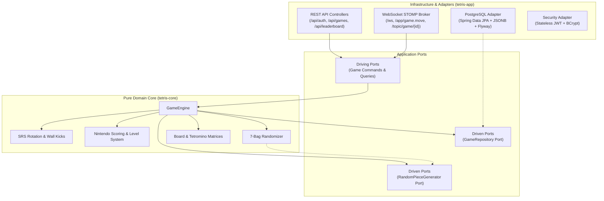
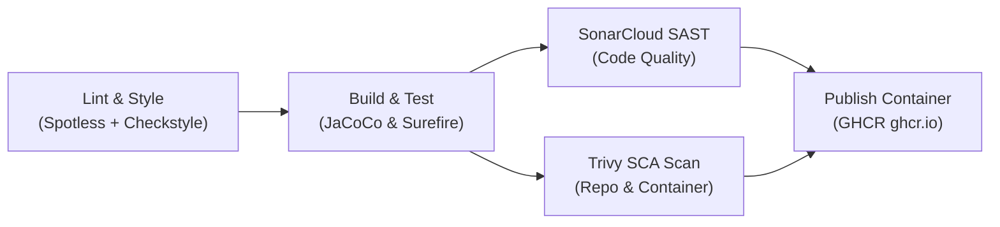

# Tetris Backend System

[](https://github.com/PaulaOramas/tetris-backend-system/actions/workflows/ci.yml)
[](https://openjdk.org/projects/jdk/21/)
[](https://spring.io/projects/spring-boot)
[](https://www.postgresql.org/)
[](https://www.docker.com/)
[](https://opensource.org/licenses/MIT)

> Enterprise-grade, production-ready backend engine for Tetris built with **Java 21**, **Spring Boot 3**, **WebSockets (STOMP)**, and **PostgreSQL 16**. Built following **Hexagonal Architecture (Ports and Adapters)**, strict **TDD**, and a fully automated **DevSecOps CI/CD pipeline** (Spotless, Checkstyle, JaCoCo, SonarCloud SAST, Aqua Trivy SCA, and GHCR container publishing).

---

## Architecture

The system is structured as a Maven multi-module project enforcing clean separation between pure domain rules and infrastructure adapters:

```
tetris-backend-system/
├── tetris-core/           # Pure domain — zero framework dependencies (Java 21 standard library only)
│   ├── model/             # Board, Tetromino (SRS), Piece, GameState, MoveType records
│   └── engine/            # GameEngine, RotationSystem (Wall Kicks), ScoringSystem, BagGenerator
│
├── tetris-app/            # Infrastructure & Framework Adapters (Spring Boot 3.3.5)
│   ├── api/               # REST Controllers (Auth, Game Lifecycle, Leaderboard)
│   ├── websocket/         # STOMP WebSocket Broker & Handlers (/ws, /app, /topic)
│   ├── persistence/       # JPA Entities, Spring Data Repositories, Flyway Migrations, JSONB converters
│   └── security/          # Stateless JWT authentication & Spring Security filters
│
├── config/                # Checkstyle rulesets & code quality configuration
└── .github/workflows/     # CI/CD DevSecOps automated pipelines
```

### Hexagonal Architecture Diagram



---

## Core Features

- **Tetris Guideline Compliance**:
  - Super Rotation System (SRS) with full wall kick tables for all 7 standard tetrominoes (`I`, `J`, `L`, `O`, `S`, `T`, `Z`).
  - Standard 10×20 playing field with boundary and occupied cell collision detection.
  - 7-Bag Random Generator ensuring fair piece distribution.
  - Original Nintendo scoring system ($100 \times \text{level}$ for single, $300$ double, $500$ triple, $800$ Tetris) and dynamic level progression.
- **Real-Time Multiplayer & Streaming**:
  - Full-duplex WebSocket STOMP messaging over SockJS.
  - Real-time move broadcasting (`/topic/game/{gameId}`) with millisecond latency.
- **Persistence & Auditing**:
  - PostgreSQL 16 storage with Flyway versioned migrations.
  - Board matrices serialized as PostgreSQL `jsonb` with audit timestamps.
- **Security & Observability**:
  - Stateless JWT authentication with HMAC-SHA256 tokens and BCrypt password encryption.
  - Spring Boot Actuator health checks and metrics (`/actuator/health`).
- **DevSecOps & Quality Assurance**:
  - Multi-stage Docker container based on `eclipse-temurin:21-jre-alpine` running as dedicated unprivileged user `tetris:tetris` (image size ~266 MB).
  - 89 automated tests (Unit, MockMvc REST, Testcontainers PostgreSQL, and WebSocket STOMP integration tests).
  - JaCoCo test coverage enforcement (>98% core domain line coverage).
  - Static code analysis with Spotless, Checkstyle, SonarCloud SAST, and Aqua Trivy SCA.

---

## API Reference

### REST Endpoints

| Method | Endpoint | Description | Auth Required |
| :--- | :--- | :--- | :---: |
| `POST` | `/api/auth/register` | Register a new user | No |
| `POST` | `/api/auth/login` | Authenticate and obtain JWT token | No |
| `POST` | `/api/games` | Start a new game session | Yes (Bearer) |
| `GET` | `/api/games/{id}` | Retrieve current game state by ID | Yes (Bearer) |
| `GET` | `/api/leaderboard` | View top global scores | No |
| `GET` | `/actuator/health` | Container readiness and liveness health probe | No |

### WebSocket STOMP Channels

| Channel | Direction | Payload | Description |
| :--- | :--- | :--- | :--- |
| `/ws` | Handshake | HTTP/SockJS | WebSocket handshake endpoint |
| `/app/game.move` | Client $\to$ Server | `{"gameId": "...", "move": "LEFT\|RIGHT\|ROTATE_CW\|ROTATE_CCW\|SOFT_DROP\|HARD_DROP"}` | Submit a player move |
| `/topic/game/{gameId}` | Server $\to$ Client | `GameStateResponse` | Broadcast game state update |

---

## Quickstart & Local Development

### Prerequisites

- [Docker](https://docs.docker.com/get-docker/) & [Docker Compose](https://docs.docker.com/compose/)
- [Java 21 JDK](https://adoptium.net/) (optional if running containerized)

### 1. Run with Docker Compose (Recommended)

Start the application and PostgreSQL 16 database with healthchecks:

```bash
# Clone the repository
git clone https://github.com/PaulaOramas/tetris-backend-system.git
cd tetris-backend-system

# Start containers in background
docker compose up -d
```

Verify service status:
```bash
docker compose ps
curl http://localhost:8080/actuator/health
```

### 2. Run Locally with Maven

```bash
# Verify formatting and static checks
./mvnw spotless:check checkstyle:check

# Run test suite (requires Docker daemon for Testcontainers)
./mvnw clean verify

# Build and install core domain into local repository
./mvnw clean install -DskipTests

# Start the Spring Boot backend
./mvnw spring-boot:run -pl tetris-app -am
```

---

## CI/CD DevSecOps Pipeline

The automated GitHub Actions workflow (`.github/workflows/ci.yml`) runs on every pull request and push to `main`:



1. **Lint & Style**: Enforces Spotless formatting and Checkstyle rules.
2. **Build & Verify**: Executes 89 unit and integration tests (Testcontainers), enforces >90% domain line coverage with JaCoCo.
3. **SAST Analysis**: Continuous code quality and security scanning with SonarCloud.
4. **SCA & Container Scanning**: Aqua Trivy scans dependencies and Docker container layers for CVEs.
5. **Release & Publish**: Builds multi-stage Docker container and publishes signed images to GitHub Container Registry (`ghcr.io`).

---

## License

This project is licensed under the MIT License — see the [LICENSE](LICENSE) file for details.
